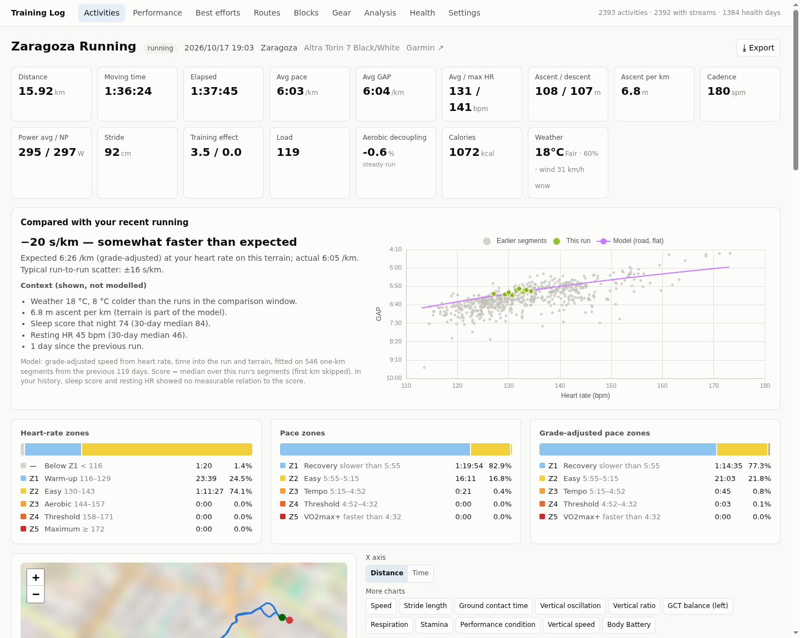
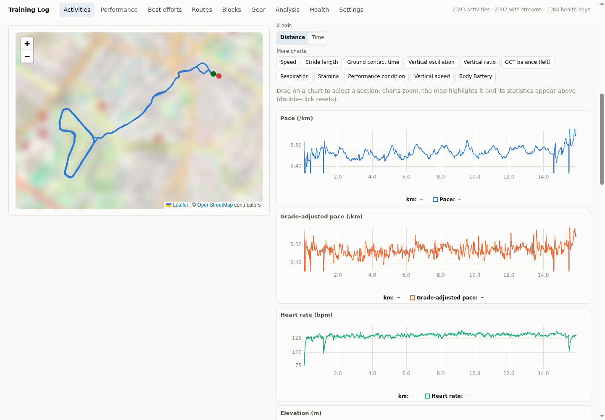
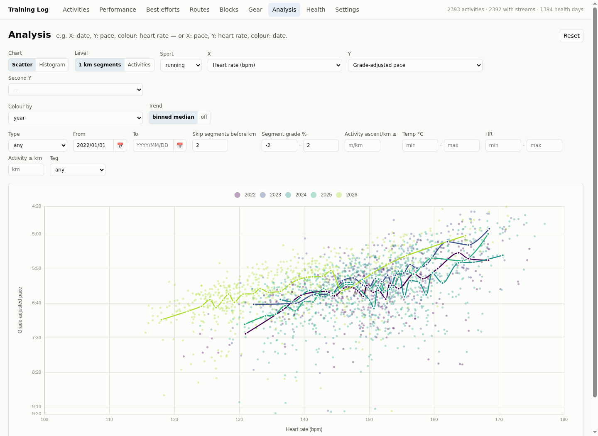
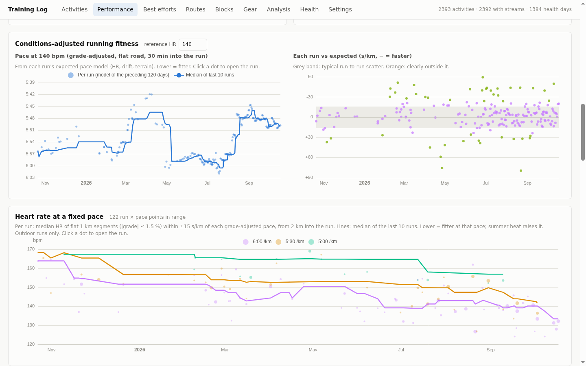
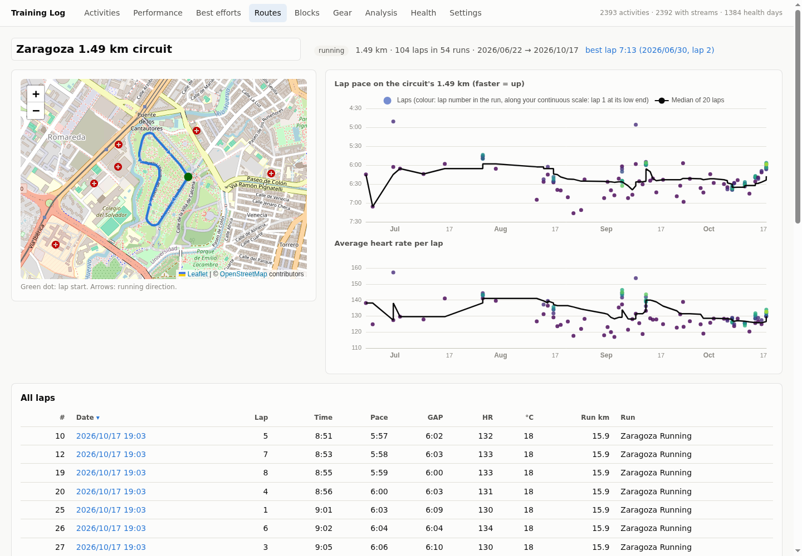
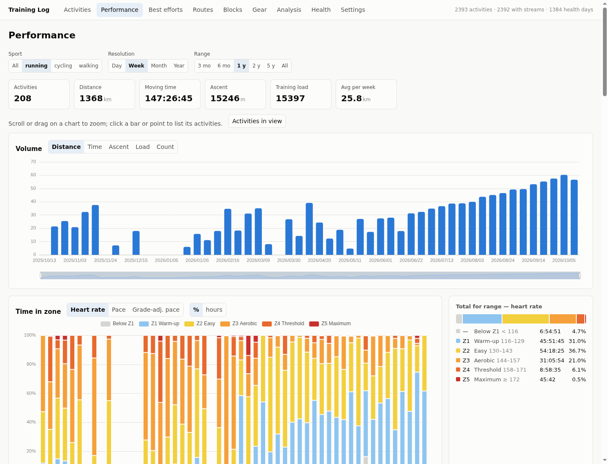
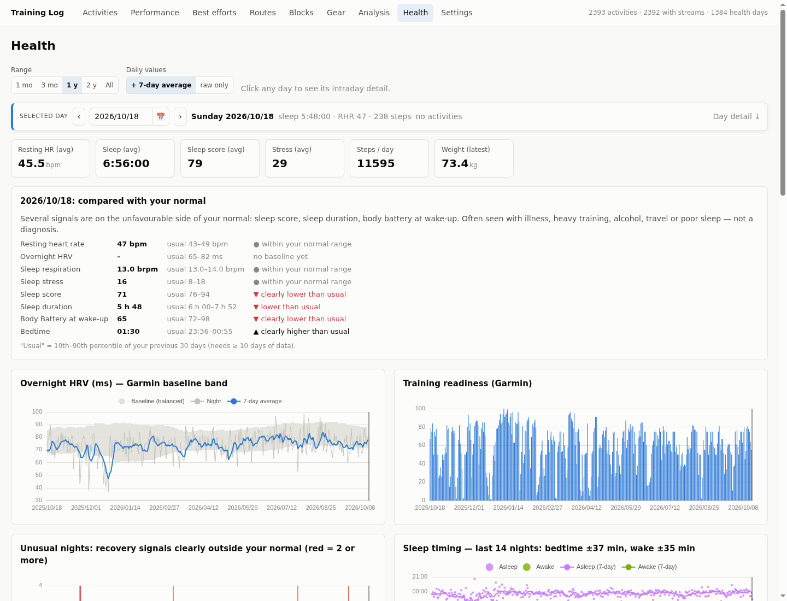
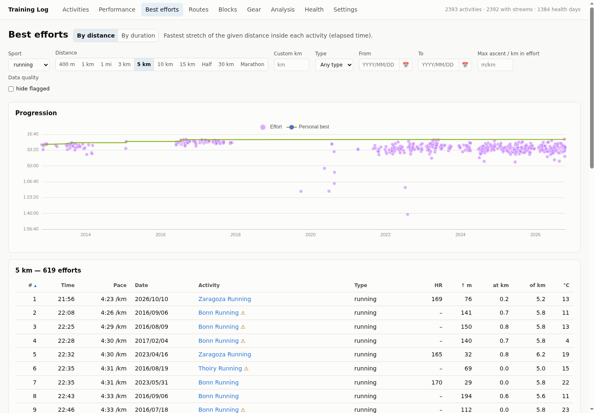
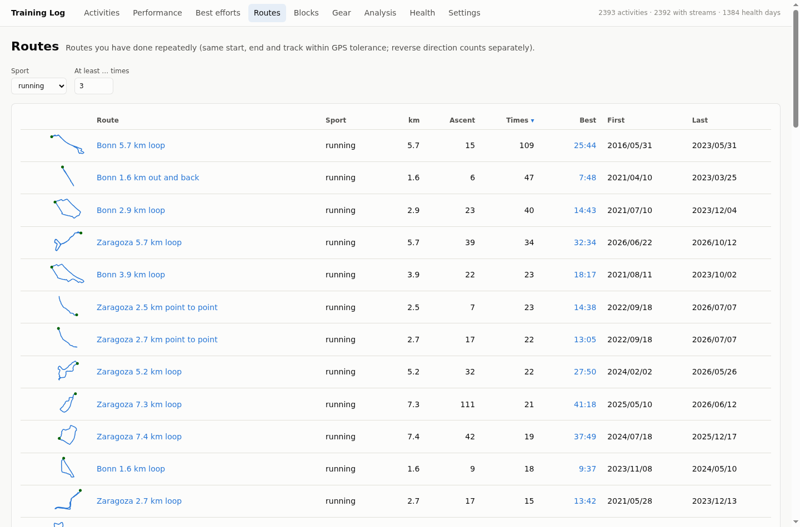
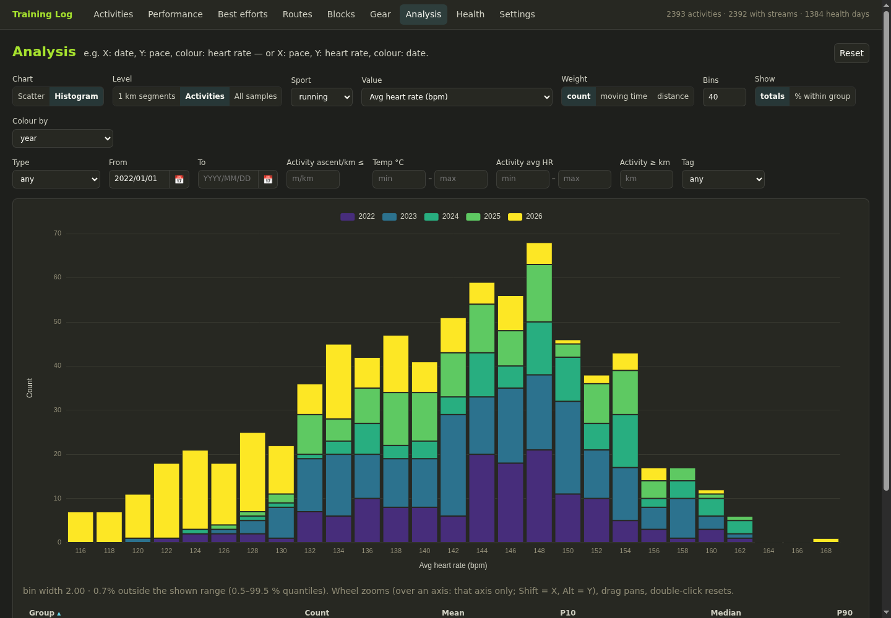

# gdi: a local analytics app for your Garmin data

**gdi** (*Garmin data interface*) turns the raw data Garmin Connect has about
you (every activity with its full per-second recording, daily health data, and
Garmin's own computed metrics) into a fast, private web app that runs on your
own machine.

It started as "I want to see my own data the way *I* want to see it" and grew
into a full training log. It has activity pages with synchronised charts, best
efforts for any distance, a free-form analysis explorer, performance and
health dashboards, automatically detected routes and loops, a training-diary
integration, and a set of carefully validated derived metrics (expected pace,
aerobic decoupling, heart-rate recovery, heart rate at a fixed pace).

- **Local-first.** Your raw JSON files are the source of truth. gdi builds an
  SQLite cache from them, which can be deleted and rebuilt in seconds. Nothing
  is uploaded anywhere. The [privacy section](#privacy) lists the only two
  outbound requests.
- **One small binary plus static files.** The server is written in
  [Nim](https://nim-lang.org) (`asynchttpserver` + SQLite). The frontend is
  plain ES modules with vendored [ECharts](https://echarts.apache.org),
  [uPlot](https://github.com/leeoniya/uPlot) and
  [Leaflet](https://leafletjs.com). There is no build step and no
  `node_modules`.
- **Honest about data quality.** GPS glitches, sparse old phone recordings,
  duplicate uploads and HR cadence lock are detected and flagged rather than
  silently turned into "records".

## Screenshots

<table>
<tr>
<td width="50%"><a href="docs/screenshots/01-activity.png"></a><br><b>Activity page:</b> tiles, "faster than expected" against your own recent form, time in zones.</td>
<td width="50%"><a href="docs/screenshots/10-activity-charts.png"></a><br><b>Map and synchronised charts:</b> drag over a chart to get the stats of that stretch.</td>
</tr>
<tr>
<td><a href="docs/screenshots/04-analysis.png"></a><br><b>Analysis:</b> heart rate vs grade-adjusted pace for every flat kilometre since 2022, warm-up skipped, coloured by year.</td>
<td><a href="docs/screenshots/03-fixed-pace-hr.png"></a><br><b>Fitness trends:</b> model pace at a reference HR, each run vs expected, and heart rate at a fixed pace.</td>
</tr>
<tr>
<td><a href="docs/screenshots/06-circuit.png"></a><br><b>Circuits:</b> a park loop found inside 54 runs, cut into 104 comparable laps.</td>
<td><a href="docs/screenshots/02-performance.png"></a><br><b>Performance:</b> volume and time in zone at any resolution, zoom-synchronised.</td>
</tr>
<tr>
<td><a href="docs/screenshots/07-health.png"></a><br><b>Health:</b> each day against your own 30-day normal, HRV band, readiness.</td>
<td><a href="docs/screenshots/05-best-efforts.png"></a><br><b>Best efforts</b> for any distance, with personal-best progression.</td>
</tr>
<tr>
<td><a href="docs/screenshots/08-routes.png"></a><br><b>Routes and circuits</b>, detected automatically.</td>
<td><a href="docs/screenshots/09-analysis-monokai.png"></a><br><b>Themes:</b> here Monokai, with a histogram of average HR per run by year.</td>
</tr>
</table>

Activity maps are blurred in these screenshots; the app shows normal OpenStreetMap tiles.

---

## Contents

- [Screenshots](#screenshots)
- [Quick start](#quick-start)
- [Getting your data](#getting-your-data)
- [Command-line reference](#command-line-reference)
- [Feature list](#feature-list)
- [How the derived metrics work](#how-the-derived-metrics-work)
- [Architecture](#architecture)
- [Privacy](#privacy)
- [Credits and licences](#credits-and-licences)

---

## Quick start

Requirements: Nim ≥ 2.0 and SQLite 3 (the system library).

```bash
git clone <this repository> gdi && cd gdi
nimble install -d          # cligen, zippy, db_connector, orgParser ≥ 0.3.0
nim c -d:release -o:gdi src/gdi.nim

# point it at your data (see "Getting your data") and start the server
./gdi serve --activities=/path/to/activities-raw \
            --health=/path/to/health-raw \
            --db=data/gdi.sqlite
# → http://127.0.0.1:8091/
```

On first start gdi imports everything; a few thousand activities take about
15 s. Afterwards it re-scans the data directories every 60 s and imports only
files whose size or modification time changed. Any sync job that writes into
those directories shows up in the UI automatically.

To put it on a server, bind to `127.0.0.1` (the default) behind a reverse
proxy, or use the built-in basic auth (`--user` / `--password`, or the
environment variables `GDI_USER` / `GDI_PASSWORD`).

---

## Getting your data

gdi reads three kinds of files. Only the first one is required.

| Directory | Content | Used for |
|---|---|---|
| `--activities` | one JSON file per activity: `<activityId>.json` | everything activity-related |
| `--health` | one JSON file per day: `<YYYY-MM-DD>.json` | the Health page |
| `<health>/../metrics/` | Garmin's computed metrics, one file per metric and year: `<metric>/<YYYY>.json` | "Garmin's assessment", HRV, readiness |

**Activity files** bundle what Garmin Connect's web API returns for one
activity. These are the top-level keys:

| Key | Content |
|---|---|
| `activityId` | the activity's ID |
| `activity` | the activity object incl. `summaryDTO`, `activityTypeDTO`, `metadataDTO` |
| `details` | the per-second time series (`metricDescriptors` + `activityDetailMetrics`) |
| `laps` | `lapDTOs` and `eventDTOs` (timer start/stop) |
| `polyline` | the GPS track |
| `weather` | Garmin's weather at the start |
| `hrTimeInZones`, `powerTimeInZones` | Garmin's zone totals |
| `splitSummaries` | Garmin's split summaries |
| `gear` | the gear linked to the activity |

Files without `details` still import (summary, laps, track) but have no
charts, zones or best efforts.

**Health day files** contain Garmin Connect's wellness data for one day:
`date`, `summary`, `sleep`, `stress`, `heartRate`, `restingHeartRate`,
`bodyComposition`, `bodyBattery`.

**Metrics** are VO₂max (with heat and altitude acclimation), HRV status, race
predictions, training status and acute/chronic load, endurance score, hill
score, lactate-threshold pace and HR, fitness age, training readiness and
running economy.

The files are written by the companion Garmin Connect client **garminApi**
(`garmin sync-raw`, `garmin sync-metrics`), which handles login, rate limits
and resumable backfills. *(garminApi is not published yet; until then, any
tool that saves the same Garmin Connect JSON responses in this layout works,
e.g. one built on [python-garminconnect](https://github.com/cyberjunky/python-garminconnect).)*

**Optional: a training diary.** gdi can show and edit tags and notes from an
Org-mode diary file. See [Training diary](#training-diary-org-mode).

---

## Command-line reference

```text
gdi serve [options]      web UI + JSON API (imports on start, then watches)
gdi import [options]     one-off import without serving
gdi link-notes [options] add Garmin activity IDs to an Org training diary
```

| `serve` option | Default | Meaning |
|---|---|---|
| `--activities` | `exercise-history.raw` | activity JSON directory |
| `--health` | `garmin-health/raw` | health day directory (metrics are read from `../metrics`) |
| `--db` | `data/gdi.sqlite` | SQLite cache (safe to delete) |
| `--port`, `--address` | `8091`, `127.0.0.1` | where to listen |
| `--watch` | `60` | re-scan interval in s (0 = off) |
| `--staticDir` | `static/` next to the binary | frontend files |
| `--user`, `--password` | – | enable HTTP basic auth |
| `--notes` | `exercise-notes.org` next to the activities dir | Org-mode diary file |
| `--weather` | `true` | backfill missing weather from Open-Meteo |

| `link-notes` option | Meaning |
|---|---|
| `--notes FILE` | the diary to link |
| `--write` | actually write it (otherwise a dry run); a timestamped `.bak` is written first |
| `--byDate` | also link entries without a URL on days with exactly one activity |
| `--verbose` | list ambiguous and skipped entries with line numbers |

---

## Feature list

Everything gdi does, page by page.

### Activities (list)

- Sortable, paged table of all activities: date, name, type, diary tags,
  distance, time, pace or speed, HR, ascent, training load, RPE (with "feel"
  in the tooltip), and a ⚠ badge for data-quality issues.
- Filters:
  - sport family and activity type;
  - free-text search over name, location, gear, type, diary notes and tags;
  - date range (YYYY/MM/DD input with a calendar button);
  - distance range and maximum ascent per km;
  - diary tag: any, with any tag, a specific tag, or without a tag;
  - hide activities with data-quality issues.
- Select activities or "select all shown", then export them (see
  [Export](#export)) or compare 2–4 of them.
- Filters are remembered per browser.

### Activity page

- **Header:** name, type, date, location, gear, a link to the repeated route
  (with this run's rank on it), a link to Garmin Connect, and an export menu.
- **Tiles:**
  - distance, moving and elapsed time, average pace or speed;
  - grade-adjusted pace (Garmin's, or estimated for older runs);
  - average and max HR, ascent and descent, ascent per km;
  - cadence, average power and normalised power, stride length;
  - aerobic and anaerobic training effect, training load;
  - aerobic decoupling (with whether the run was steady enough to interpret
    it);
  - perceived effort (RPE 1–10 and "feel") and calories;
  - weather: temperature, conditions, humidity and wind, marked "via
    Open-Meteo" when backfilled.
- **Map:** OpenStreetMap with start and finish. A marker follows the cursor
  on the charts, and the selected range is highlighted on the map.
- **Synchronised time-series charts** (uPlot), switchable between distance
  and time on the x axis:
  - pace, speed, grade-adjusted pace, heart rate, elevation;
  - run or bike cadence, power, stride length;
  - ground contact time, vertical oscillation, vertical ratio, GCT balance;
  - respiration rate, stamina, performance condition;
  - temperature, vertical speed, Body Battery.

  Every chart the recording supports can be shown, with sensible smoothing.
- **Range selection:** drag over any chart to get the stats of that stretch
  (distance, moving and elapsed time, pace, grade-adjusted pace, average and
  max HR, ascent and descent, net grade, cadence, power).
- **Time in zones** for heart rate, pace and grade-adjusted pace, using your
  own zones.
- **"Faster / slower than expected":** the run compared with what your recent
  form predicts for its HR, drift and terrain. See
  [Expected pace](#expected-pace-model).
- **Tables:**
  - kilometre splits and laps;
  - best efforts inside this activity with their all-time rank;
  - heart-rate recoveries (HR drop after hard stretches);
  - circuit laps (time, pace, grade-adjusted pace, HR, difference from the
    circuit's median lap, and rank);
  - similar runs, ranked by shared track, each with a one-click compare.
- **Diary card:** the day's entry from your Org diary, other activities in the
  same entry, an editable tag list, and an "append a note" box.
- **Data-quality note** listing every issue found, with a link to the kept
  copy for duplicate uploads.
- The raw Garmin JSON, for the curious.

### Best efforts

- **By distance:** the fastest stretch of any distance inside every activity.
  Standard distances from 400 m to 200 km are precomputed; any other distance
  is computed on the fly.
  - A table and a chart over time, with your personal-best progression.
  - Filters: sport, type, date range, maximum ascent per km, hide flagged
    activities.
- **By duration:** mean-maximal curves for pace, grade-adjusted pace and
  power, from 10 s to 3 h.
  - Compare two periods (e.g. the last 90 days against the 90 days before).
  - A **critical speed** and **D′** estimate fitted on your 3–20 min bests,
    with warnings when the fit is unreliable.

### Routes, circuits and comparison

- **Repeated routes**, detected automatically: same sport, start, end and
  track within GPS tolerance. Reverse direction counts as a different route.
  - A route list with track sketches and editable names.
  - A page per route: map, moving time and average HR per run, "vs expected"
    per run, and a ranked table of all runs.
- **Circuits:** loops you run several times *within* a run, like laps of a
  park or a track.
  - Detected from the GPS tracks and clustered across runs.
  - Each run is cut into laps from the point on the circuit that gives the
    most complete laps.
  - A page per circuit: map with direction arrows, lap pace and lap HR over
    time (coloured by lap number), a rolling median, and a sortable table of
    every lap. Names are editable.
- **Similar runs:** for every run, the runs sharing the most track with it,
  in the same direction. The same route ranks first, then runs that share
  only parts.
- **Compare 2–4 activities:** pace, HR and elevation overlaid by distance, a
  running time gap, and key statistics side by side.

### Performance (dashboard)

- Controls for sport, resolution (day / week / month / year) and range
  (3 months to all). All time charts zoom together. Click a bar or point, or
  "Activities in view", to list the activities behind it.
- **Summary tiles:** activities, distance, moving time, ascent, training load,
  average per week.
- **Volume:** distance, time, ascent, load or count per period.
- **Time in zone** per period (HR, pace or grade-adjusted pace; % or hours),
  with totals for the visible range.
- **Aerobic efficiency:** metres per heartbeat.
- **Training load:** acute vs chronic.
- **Conditions-adjusted running fitness:** your model pace at a chosen
  reference HR over time, and each run vs expected, with a band for typical
  run-to-run scatter.
- **Heart rate at a fixed pace:** per run, the median HR of flat kilometres
  at 6:00, 5:30 and 5:00 /km grade-adjusted pace (from 2 km in). This is a
  direct fitness signal that doesn't depend on the watch's max-HR setting.
- **Aerobic decoupling** of steady runs above a chosen minimum duration.
- **Heart-rate recovery trend:** HR drop after 60 or 120 s, filtered by peak
  HR, with walking and jogging recoveries marked separately.
- **Garmin's assessment**, shown next to your own measures and never on a
  shared axis:
  - VO₂max and running economy;
  - race predictions against your actual 90-day bests;
  - endurance score and hill score;
  - lactate-threshold pace and training status;
  - acute vs chronic load and fitness age;
  - heat and altitude acclimation.

### Training blocks

- Compare two date ranges, e.g. the last 4 weeks against the 4 before, the
  last 12 weeks against a year earlier, or year to date against last year:
  - volume per week and a week-by-week series;
  - HR and pace zone mix;
  - expected-pace delta, model pace at 140 bpm, decoupling;
  - average HR and grade-adjusted pace;
  - best efforts and mean-max bests inside each block;
  - health averages over the same days (resting HR, HRV, sleep, stress,
    readiness, VO₂max, steps, weight).
- Each difference is labelled "better" or "worse" where the direction is
  unambiguous.

### Gear

- Every shoe or bike with Garmin's usage total against its target distance.
- Per pair: medians of expected-pace delta, decoupling, HR, grade-adjusted
  pace, cadence, stride, ascent per km and trail share.
- A gear × month heatmap of when you used what.

### Analysis (explorer)

- **Scatter or histogram** of any metric against any other, per 1 km segment
  or per activity. Histograms can also use all per-second samples.
- **About 60 metrics per level:**
  - pace, grade-adjusted pace, HR, efficiency;
  - grade, ascent and descent;
  - cadence, stride, ground contact time, vertical oscillation and ratio, GCT
    balance, power;
  - respiration, stamina, performance condition;
  - temperature (weather and watch sensor), humidity, dew point, wind;
  - training load and effect, RPE and feel;
  - decoupling, pace variability, expected-pace delta, HR-recovery drops;
  - Garmin's summary values;
  - date, year, hour of day.

  At segment level, every whole-activity value is available as well.
- **Second Y metric**, overlaid when it shares the unit, otherwise in a
  linked panel.
- **Colour by** either a group (year, activity type, gear, temperature band)
  or a metric (continuous scale), with a binned-median trend line per group.
- **Filters:**
  - activity type, date range, diary tag;
  - segment grade, activity ascent per km, temperature, HR;
  - minimum activity length;
  - "skip segments before km X", to drop the warm-up where HR still lags.
- **Histogram options:** weight by count, moving time or distance; bin count;
  totals or % within group; a stats table (mean, P10, median, P90) per group.
- Zoom per axis with the mouse wheel. Click a point to open its activity.
- Views can be bookmarked via URL parameters. A Reset button returns to the
  default chart.

### Health

- **Daily charts:** resting HR, sleep, sleep score, stress, Body Battery,
  steps, sleep respiration, intensity minutes, weight. A 7-day average can be
  toggled on.
- **HRV status** with Garmin's baseline band, and **training readiness** with
  its six factor scores.
- **Personal baselines:** every daily signal is shown against the 10th–90th
  percentile of your own previous 30 days.
- **"Unusual nights":** nights where several recovery signals (resting HR ↑,
  HRV ↓, sleep respiration ↑, sleep stress ↑) were clearly outside your
  normal at the same time.
- **Sleep timing:** bed and wake time, with 7-day averages.
- **Selected-day bar** (sticky): previous/next day, date picker, the day's
  tags and activities.
- **Day detail:**
  - "compared with your normal";
  - intraday HR, stress and Body Battery;
  - the day's activities;
  - the day's diary entries.

### Training diary (Org mode)

- Reads a hand-written [Org-mode](https://orgmode.org) diary (one heading per
  day) through [orgParser](https://github.com/Vindaar/orgParser)'s lossless
  mode.
  - An entry belongs to the activities in its `:GARMIN_ID:` property, or to
    the Garmin Connect URLs it mentions. Entries without either are day notes.
  - Entry text shows on the activity page and in Health. Tags appear as a
    column, filter and search on Activities, and as a filter in Analysis.
- **The web UI never touches your prose.** It can only:
  - change a heading's tags (rejected if the file changed in the meantime);
  - append a timestamped note at the end of the day's text.

  Every write re-reads the file first, is atomic, and changes only the
  affected lines.
- **`gdi link-notes`** adds `:GARMIN_ID:` properties to an existing diary
  without changing a single original line:
  - It uses Garmin Connect URLs as proof and cross-checks heading dates.
  - It verifies the result with `diff` and keeps a backup.
  - It prints only counts and line numbers, never diary text.

### Export

- From an activity page or for any selection on Activities, in three levels:

  | Level | Contains | GPS | Account IDs |
  |---|---|---|---|
  | `summary` | the activity without time series, plus gdi's own computed values | removed | removed |
  | `data` | summary plus every time series | removed | removed |
  | `full` | the raw file exactly as synced | included | included |

- Formats: JSON, CSV, and GPX (with HR and cadence). Several activities come
  as a zip. Diary notes are never exported.

### Settings and appearance

- HR zones (defaults from Garmin's HR-reserve zones) and pace zones (as
  fractions of your threshold pace). Changes apply to all history instantly.
- Zone colours: presets with tuned dark-mode variants, or your own.
- **Themes:** System, Light, Dark, Sepia, Nord, Monokai, Monokai vivid, Black
  (OLED), High contrast. The choice is stored per browser.
- **Series colours:**
  - the theme's palette (checked for colour-blind separation);
  - ggplot2's default hue scale with 8 fixed hues;
  - ggplot2's hue scale with *n* hues per chart.
- **Continuous colour scale** (Viridis, Magma, Plasma, Cividis, Blues,
  reversible), and whether ordered groups use it.
- Dates are shown as YYYY/MM/DD everywhere.

### Data processing (behind the scenes)

- Incremental import with a file watcher. The SQLite cache is versioned and
  rebuilt automatically when the importer changes.
- **Glitch-cleaned distance** for records and curves. Every activity gets
  data-quality flags: GPS jumps, implausible speed, impossible stride, sparse
  sampling, HR cadence lock, missing HR, duplicate uploads.
- **Grade-adjusted pace estimated for runs without it**, using Garmin's own
  grade → effort curve (measured from runs that have both). It matches
  Garmin's activity average within about 2.4 s/km.
- Per-kilometre segments with about 18 averaged channels, HR and speed histograms,
  and mean-maximal curves.
- **Weather backfill** from Open-Meteo for activities without Garmin weather.
- Pauses are respected: averages use moving time; best efforts use wall-clock
  time, so a pause can never make an effort look faster.

---

## How the derived metrics work

The goal is to compute things in ways that hold up, so each method was checked
against the data rather than assumed. Short summaries, with details in the
source:

- **Expected-pace model** (`gdi_models.nim`). For each run, a weighted
  least-squares model of the previous 120 days' running kilometres predicts
  grade-adjusted speed from HR, time into the run, trail vs road and
  climbing. The HR slope is shrunk towards the all-history slope. The run's
  score is the median of actual − expected pace over its kilometres. Its
  run-to-run scatter, tested out of sample, is lower than a plain speed/HR
  ratio.
- **Aerobic decoupling.** Efficiency (grade-adjusted speed ÷ HR, or power ÷
  HR) of the second vs the first half after a 10 min warm-up. It is only
  interpreted on runs whose 1-minute output varies ≤ 12 %.
- **Heart-rate recovery.** A hard stretch ends where the last 60 s of
  grade-adjusted pace are ≥ 1.15 × the run's median and the next 60 s
  ≤ 0.7 × that. gdi then reports the HR drop 60 s and 120 s after the peak.
  It was checked against interval sessions with known lap ends.
- **Distance cleaning.** Per-second distance is lumpy, so instead of judging
  single steps, a speed-based allowance accrues over 5 s, and only distance
  beyond it is dropped. Each step is also capped per sport. On modern watch
  data this changes best efforts by ≤ 1 % on average, while removing real GPS
  jumps.
- **Circuits** (`gdi_circuits.nim`). Tracks are resampled every 10 m. Points
  match within 20 m when heading the same way (±60°), so the two directions
  of an out-and-back never match. A loop is a stretch the run covers again one
  loop length later. Laps must be about one circuit long (±10 %) and stay on
  it (≥ 90 %). Pace uses the circuit's length, so laps compare on a fixed
  distance.
- **Weather backfill.** Open-Meteo's ERA5 reanalysis for the start hour.
  Against Garmin's own weather on 40 activities: temperature within a median
  of 1.3 °C, humidity about 7 points.

---

## Architecture

```text
Garmin Connect ──(garminApi sync)──▶ activities-raw/<id>.json ─┐
                                    health-raw/<date>.json ───┤
                                    metrics/<metric>/<y>.json ─┤
                                    diary.org (optional) ──────┤
                                                               ▼
                         gdi (import on change) ──▶ data/gdi.sqlite ──▶ JSON API ──▶ web UI
```

| Path | Purpose |
|---|---|
| `src/gdi.nim` | CLI: `serve`, `import`, `link-notes` |
| `src/gdi_db.nim` | schema, migrations, compressed float32 stream storage |
| `src/gdi_import.nim` | raw JSON → tables: cleaning, segments, best efforts, histograms, flags |
| `src/gdi_models.nim` | history-wide models: expected pace, repeated routes |
| `src/gdi_circuits.nim` | shared track between runs, circuits and laps |
| `src/gdi_metrics.nim` | Garmin's computed metrics |
| `src/gdi_notes.nim`, `src/gdi_linknotes.nim` | Org-mode diary |
| `src/gdi_weather.nim` | Open-Meteo weather backfill |
| `src/gdi_export.nim` | JSON / CSV / GPX export |
| `src/gdi_server.nim` | JSON API and static files |
| `static/` | the single-page app (`js/<page>.js`), styles, vendored libraries |

**JSON API** (all `GET` unless noted):

| Endpoint | Returns |
|---|---|
| `/api/activities` | every activity (summary columns, tags) |
| `/api/activity/<id>`, `/api/activity/<id>/streams` | one activity incl. laps, splits, efforts, circuits, similar runs; its time series |
| `/api/efforts?distance&family`, `/api/mmp?metric&family&from&to` | best efforts, mean-max curves |
| `/api/segments?family`, `/api/zones?family&group&kind`, `POST /api/hist` | 1 km segments, time in zone, sample histograms |
| `/api/routes`, `/api/route/<id>`, `/api/circuits`, `/api/circuit/<id>` | routes and circuits |
| `/api/block?family&from&to`, `/api/gear`, `/api/hr-recovery` | blocks, gear, recoveries |
| `/api/health`, `/api/health/<date>`, `/api/garmin-metrics` | health days, Garmin's metrics |
| `/api/diary?date`, `/api/tags`, `POST /api/activity/<id>/tags`, `POST /api/activity/<id>/append` | diary |
| `/api/export?ids&level&format` | downloads |
| `GET/POST /api/settings`, `/api/status`, `POST /api/reimport` | settings, status, rescan |

Bumping `ImporterVersion` in `gdi_import.nim` forces a full re-import when
derived data changes. The frontend needs no build: edit a file and reload.

---

## Privacy

gdi reads your files and serves them to your browser. It makes only these
outbound requests:

- **Map tiles** from openstreetmap.org, when a page shows a map.
- **Open-Meteo**, for activities without Garmin weather. Only the start
  position rounded to 0.1° (about 10 km) and the date are sent. Turn this off
  with `--weather=false`.

Exports at the `summary` and `data` levels strip GPS coordinates and account
identifiers. Diary text is never exported.

---

## Credits and licences

- [ECharts](https://echarts.apache.org) (Apache-2.0),
  [uPlot](https://github.com/leeoniya/uPlot) (MIT) and
  [Leaflet](https://leafletjs.com) (BSD-2-Clause) are vendored in
  `static/vendor/`.
- Map data © [OpenStreetMap](https://www.openstreetmap.org/copyright)
  contributors.
- Weather data by [Open-Meteo.com](https://open-meteo.com) (CC BY 4.0).
- Nim libraries: [cligen](https://github.com/c-blake/cligen),
  [zippy](https://github.com/guzba/zippy),
  [db_connector](https://github.com/nim-lang/db_connector),
  [orgParser](https://github.com/Vindaar/orgParser).
- Not affiliated with or endorsed by Garmin. Garmin, Garmin Connect, Body
  Battery and related names are trademarks of Garmin Ltd.

**Licence:** MIT, see [LICENSE](LICENSE).
